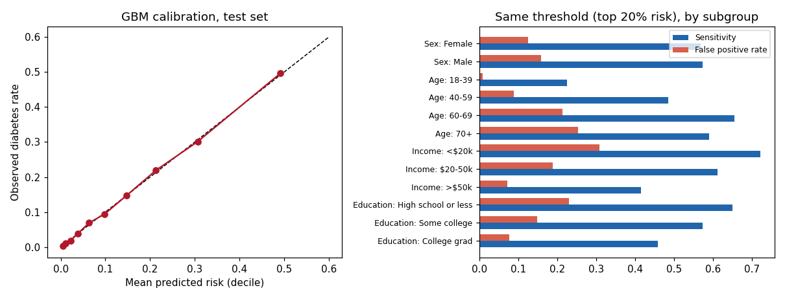

# Diabetes risk model from survey answers, with a subgroup check

Can you flag people likely to have diabetes from a short health survey, and does the model work equally well for different groups? I trained two models on the CDC's 2015 BRFSS survey, then checked sensitivity and false positives by sex, age, income and education at one fixed threshold. Both models are written from scratch in numpy/scipy (L-BFGS logistic regression, and gradient boosted trees with histogram splits), because the sandbox I worked in had no scikit-learn.

## Data

CDC Diabetes Health Indicators, UCI dataset 891 (https://archive.ics.uci.edu/dataset/891), built from the 2015 Behavioral Risk Factor Surveillance System. 253,680 respondents, 21 survey answers. The outcome is "Diabetes_binary": 1 means the person said a doctor told them they have diabetes or prediabetes, 0 means no. 13.9% are 1. The CSV is 13 MB so it is not in the repo: run `python src/fetch.py`.

## Method

- Random 70/30 split (177,576 train, 76,104 test), seed 0. This is a random split of one survey year, not a test on a different year or state.
- Logistic regression with a light L2 penalty on standardised inputs.
- Gradient boosting: 200 trees, depth 3, learning rate 0.1, 32 bins, second-order updates. Hyperparameters were set once and not tuned.
- AUC computed by ranks with tie handling. Confidence interval from 200 bootstrap resamples of the test set.
- Subgroup check: flag the top 20% of predicted risk and compare each group's sensitivity, false positive rate and positive predictive value.

## Results

| Model | Test AUC |
|---|---|
| Logistic, all 21 features | 0.822 |
| Boosted trees, all 21 features | 0.831 (95% CI 0.827 to 0.835) |
| Logistic, without self-rated health | 0.808 |
| Boosted trees, without self-rated health | 0.816 |
| Logistic, 8 features | 0.816 |
| Boosted trees, 8 features (BP, cholesterol, BMI, age, health rating, activity, smoking, sex) | 0.823 |

- Trees beat logistic regression by about 0.01 AUC. Eight answers get you almost all of the way. Most of the signal is in high blood pressure, BMI, age and how people rate their general health (the largest odds ratio, 1.78 per standard deviation).
- The predicted risks are well calibrated: the decile curve sits on the diagonal (see figure).
- At a fixed budget of flagging the top 20%, the model catches 57% of cases and 40% of the flagged people have the condition.

### Subgroup audit (same threshold for everyone)

| Group | Prevalence | AUC | Sensitivity | False positive rate |
|---|---|---|---|---|
| Female | 13.0% | 0.843 | 56.8% | 12.6% |
| Male | 15.2% | 0.815 | 57.4% | 15.8% |
| Age 18-39 | 2.9% | 0.841 | 22.5% | 0.9% |
| Age 70+ | 20.7% | 0.747 | 59.0% | 25.3% |
| Income under $20k | 24.0% | 0.783 | 72.2% | 30.8% |
| Income over $50k | 9.3% | 0.840 | 41.5% | 7.2% |
| High school or less | 19.1% | 0.795 | 65.0% | 23.1% |
| College graduate | 9.7% | 0.851 | 45.8% | 7.7% |

Full table: `data/subgroup_audit.csv`.

What this shows:
- Sex looks balanced on sensitivity (57% vs 57%). Men get a few more false positives.
- Income, education and age do not. One threshold finds 72% of cases in the lowest income group but 42% in the highest, and flags 31% vs 7% of the people without the condition. Most of that follows prevalence: when a group has more diabetes, the model scores everyone in it higher.
- The model ranks people worse inside older groups (AUC 0.75 for 70+ vs 0.84 for under 60). A likely reason is that age is already doing much of the sorting there, but I did not test that.
- Setting a separate threshold per group to equalise sensitivity is possible (`data/equal_sensitivity_thresholds.csv`) but it moves the cost somewhere else: lower thresholds for the high-income group means flagging more of its healthy people. Which is "fair" depends on what the screening is for, and I don't pick one here.



## Limits

- Everything is self-reported. Undiagnosed diabetes is counted as "no", so this predicts who has a diagnosis, not who has the disease. People with poorer access to care are more likely to be undiagnosed, which would make the subgroup gaps look different from reality.
- The outcome mixes diabetes and prediabetes.
- One year (2015), one random split. Performance on later years or other populations is untested.
- The survey has no labs (HbA1c, glucose). It is a screening-style model, not a diagnostic one.
- Subgroups are single columns, with no intersections (for example older and low income). Small cells would be noisy.
- Not a medical device and not validated for clinical use.

## Run it

```
pip install numpy pandas scipy matplotlib
python src/fetch.py
python src/analyze.py     # about 2 minutes
```
